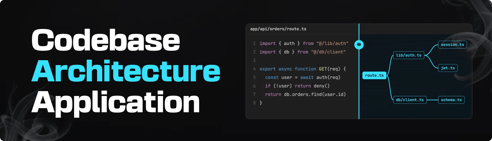

# Cartograph | Codebase Dependency Mapper



<!-- Badges follow the Stack section's order: app, then tooling, then planned services. -->

[](https://tanstack.com/start)
[](https://react.dev)
[](https://vite.dev)
[](https://ui.shadcn.com)
[](https://tailwindcss.com)
[](https://www.typescriptlang.org)
[](https://pnpm.io)
[](https://turborepo.com)
[](https://clerk.com)
[](https://supabase.com)
[](https://www.coderabbit.ai)

> The name comes from **cartography**, the craft of making maps: French _carte_ (map, ultimately from Greek _khartēs_) and _-graphie_ (from Greek _graphein_, to write or draw). A **cartographer** is the person who makes them.
>
> A cartographer surveys unknown ground and turns it into a map people can trust. Cartograph does that for a codebase you didn't write.

A dependency map of any public TypeScript or JavaScript repository, drawn from the code itself.

## About

Paste a public TypeScript or JavaScript repository and get a map of it: folders
as boxes, imports as lines between them. Every box and every line comes from
parsing the real code; nothing on the map is guessed.

Cartograph is being built as a monorepo. This repository holds the web
app, its UI package, the parser, framework detection and the map so far.

## Features (planned)

- **Real parsing**: imports, re-exports, dynamic imports and `require()` become edges. An import that can't be resolved is reported with a reason, never guessed.
- **Coverage report**: how much of the repository was parsed, and why the rest wasn't.
- **Interactive map**: folders fold into boxes and expand into files; select a file to highlight what flows into and out of it.
- **Blast radius and dependency chains**: arithmetic over the edge list, shown instantly with no network request.
- **Grounded explanations**: a paragraph about a file, written from the file and its real neighbours, cached, and checked never to name a file that doesn't exist.
- **Repository chat**: an agent that looks facts up and shows its lookups before it answers. Graph walks are done by the same arithmetic that draws the map, never by the model.
- **Organizations**: analyses belong to an organization; access is enforced by Postgres row-level security, not by application code.
- **Live progress** while a repository is being parsed.

## Stack

The specs name no stack; any stack that provides the capabilities they ask
for can build Cartograph. This is what this repository uses. The reasons, and
the alternatives considered, are in
[ADR 0001](docs/adr/0001-stack-and-repository-layout.md).

In this repository now:

- [TanStack Start](https://tanstack.com/start) and
  [TanStack Router](https://tanstack.com/router), on React 19 and Vite 8
- [shadcn/ui](https://ui.shadcn.com) on [Base UI](https://base-ui.com), with
  Tailwind CSS 4
- TypeScript 6, ESLint 10 (`@tanstack/eslint-config`), Prettier
- [pnpm](https://pnpm.io) workspaces and [Turborepo](https://turborepo.com)
- [React Flow](https://reactflow.dev) and [dagre](https://github.com/dagrejs/dagre) for the map and its layout

Planned, not yet installed:

- [Clerk](https://clerk.com) for sign-in and organizations
- [Supabase](https://supabase.com) Postgres, with row-level security
- [LangSmith](https://www.langchain.com/langsmith) for tracing AI calls
- [CodeRabbit](https://www.coderabbit.ai) for pull-request review

## Layout

A modular monolith in a monorepo: one deployable app, with its code split
into packages that reach each other only through declared dependencies.

```text
apps/
  web/          the TanStack Start app
packages/
  ui/           shared UI: shadcn components, the theme (globals.css), cn
  parser/       a directory on disk in; files, imports, edges and coverage out
  frameworks/   each package's framework, file roles, entry points and routes
  graph/        the map's arithmetic: folding, labels, layout, selection
  golden/       dev-only: downloads the golden repositories the tests pin
```

Each package has a README: what it is, why it's a package of its own, and
how to use it.

Dependency versions shared between packages are defined once, in the
[catalog](https://pnpm.io/catalogs) in `pnpm-workspace.yaml`; packages refer to
them as `catalog:`.

## Getting started

Requires Node.js 24 and pnpm (the version is set by
`packageManager` in `package.json`).

```bash
pnpm install
pnpm dev
```

The app runs at <http://localhost:3000>.

## Scripts

Run from the repository root. Turborepo runs `dev`, `build`, `lint`,
`typecheck` and `test` in each package; Prettier runs once over the whole
repository.

| Script              | What it does                                             |
| ------------------- | -------------------------------------------------------- |
| `pnpm dev`          | Starts the app in development mode                       |
| `pnpm build`        | Builds the app                                           |
| `pnpm lint`         | Lints every package                                      |
| `pnpm typecheck`    | Type-checks every package                                |
| `pnpm test`         | Runs every package's tests (Vitest)                      |
| `pnpm format`       | Formats every file in the repository with Prettier       |
| `pnpm format:check` | Checks formatting without writing (this is what CI runs) |

## Deploying

The app is hosted on Vercel and built by Nitro
([ADR 0002](docs/adr/0002-hosting-on-vercel-with-nitro.md)): every pull
request gets a preview address, and `main` deploys to production. Setting up
the Vercel project is in
[spec 000's tasks](docs/specs/000-platform-requirements/tasks.md).

## Adding UI components

With the shadcn CLI, registry first: the steps are in
[packages/ui/README.md](packages/ui/README.md#adding-components).

## Agent skills

Claude Code skills live in `.claude/skills/`, pinned in `skills-lock.json`.
Always install with `-a claude-code --copy`:

```bash
pnpm dlx skills@latest add <source> --skill <name> -a claude-code --copy -y
pnpm dlx skills@latest update
```

TanStack's own skills ship inside its packages and load through
[TanStack Intent](https://tanstack.com/intent/latest/docs/getting-started/quick-start-consumers):
`pnpm exec intent list`.

Every command, the reason for each flag, and what's installed are in
[docs/bookmarks.md](docs/bookmarks.md#agent-skills).

## References

Start with [docs/specs/README.md](docs/specs/README.md): it says what to read
first, whether you're building Cartograph your own way or working on this
repository.

- [Project doc](docs/project-doc.md): what Cartograph is and why each decision was made
- [Glossary](CONTEXT.md): one meaning per term, used by the specs, the code and the interface
- [Specs](docs/specs/README.md): the thirteen capabilities, in build order
- [Decision records](docs/adr/): hard-to-reverse choices, with the trade-off behind each
- [AGENTS.md](AGENTS.md): how to work in this repository: the rules for packages, the interface, rendering, performance and accessibility
- [Bookmarks](docs/bookmarks.md): useful external references, and the installed agent skills

## License

Proprietary. All rights reserved; see [LICENSE](LICENSE).
